# Building a Pytest Test Framework: Best Practices Guide

> A practical overview of how a well-structured Python + pytest test framework is organized,
> with the established conventions that keep it fast, reliable and maintainable as it grows.
>
> **Diagrams** are written in [Mermaid](https://mermaid.js.org/). They render on GitHub/GitLab and in
> VS Code with a Mermaid preview extension (e.g. *Markdown Preview Mermaid Support*).
>
> **Code blocks** are illustrative snippets, not a complete framework. Examples use a lab/hardware
> flavour (DUT = *Device Under Test*, PSU = *Power Supply Unit*), but every principle applies to
> any pytest project.

---

## Table of Contents

1. [Guiding Principles](#1-guiding-principles)
2. [Architecture Overview](#2-architecture-overview)
3. [Project Layout](#3-project-layout)
4. [Configuration (`pyproject.toml`)](#4-configuration-pyprojecttoml)
5. [Naming & Test Discovery](#5-naming--test-discovery)
6. [Anatomy of a Good Test](#6-anatomy-of-a-good-test)
7. [Fixtures](#7-fixtures)
8. [Parametrization](#8-parametrization)
9. [Markers & Test Selection](#9-markers--test-selection)
10. [Assertions & Exceptions](#10-assertions--exceptions)
11. [The Abstraction Layer (Drivers / Adapters)](#11-the-abstraction-layer-drivers--adapters)
12. [Isolation: Mock vs. Simulate vs. Real](#12-isolation-mock-vs-simulate-vs-real)
13. [Environments & Command-Line Options](#13-environments--command-line-options)
14. [Hooks & Plugins](#14-hooks--plugins)
15. [Logging & Reporting](#15-logging--reporting)
16. [Reliability: Waits, Timeouts, Flakiness, Ordering](#16-reliability-waits-timeouts-flakiness-ordering)
17. [Parallel Execution](#17-parallel-execution)
18. [Code Quality Tooling](#18-code-quality-tooling)
19. [CI/CD Integration](#19-cicd-integration)
20. [Suite Strategy: The Test Pyramid](#20-suite-strategy-the-test-pyramid)
21. [CLI Cheat Sheet](#21-cli-cheat-sheet)
22. [Recommended Plugins](#22-recommended-plugins)
23. [Anti-Patterns](#23-anti-patterns)
24. [Review Checklist](#24-review-checklist)
25. [References](#25-references)

---

## 1. Guiding Principles

| Principle                     | What it means in practice                                                                                |
|:------------------------------|:---------------------------------------------------------------------------------------------------------|
| **Independent tests**         | Every test sets up what it needs and cleans up after itself. Tests pass in any order, alone or together. |
| **Deterministic**             | No `time.sleep()` for synchronization, no unseeded randomness, no reliance on wall-clock timing.         |
| **Fast feedback first**       | Most tests run without real hardware or network, in seconds. Slow or lab tests run less often.           |
| **Layered design**            | Tests describe *what* is verified. Lower layers know *how* to talk to devices, files and services.       |
| **Explicit over magic**       | Tests request fixtures by name. `autouse` is the exception, not the rule.                                |
| **Config, not code**          | No hard-coded paths, addresses, credentials or environment names inside tests.                           |
| **Fail loud and informative** | A failure message tells you *what* was expected, *what* happened and *where*, without re-running.        |
| **Readable like a spec**      | Test names and bodies read as a description of required behaviour.                                       |

---

## 2. Architecture Overview

A good framework separates **test intent** from **test mechanics**. Dependencies only point
**downward**: a test never imports a transport library (VISA, serial, HTTP) directly.

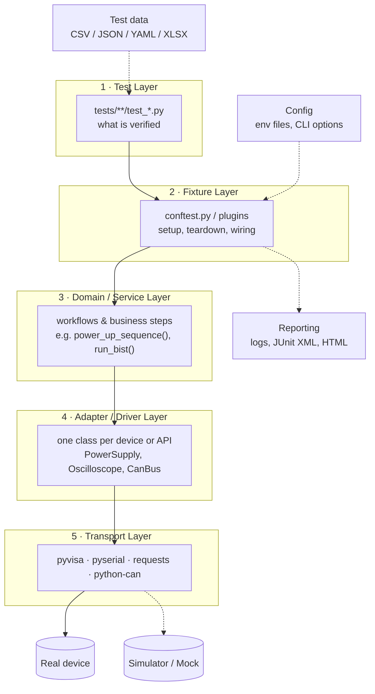

| Layer | Owns | Must NOT contain |
|:--|:--|:--|
| Test | Scenario, expected values, assertions | Connection strings, raw SCPI commands, sleeps |
| Fixture | Lifecycle (open/close, power on/off), dependency wiring | Assertions about product behaviour |
| Domain/Service | Multi-step workflows reused by many tests | pytest imports (keep it plain Python) |
| Adapter/Driver | Device/API protocol, units, error translation | Test logic, pass/fail decisions |
| Transport | Bytes on the wire | Anything project-specific |

> **Rule of thumb:** if you replace a device with a different vendor model, only the **Adapter** layer
> should change. If you change a requirement, only the **Test** layer should change.

---

## 3. Project Layout

```text
project-root/
├── pyproject.toml              # single source of truth: deps + tool config
├── README.md
├── src/
│   └── labkit/                 # framework code, installable package
│       ├── __init__.py
│       ├── exceptions.py       # project exception hierarchy
│       ├── config/
│       │   ├── settings.py     # typed Settings dataclass
│       │   └── loader.py       # reads env files + env vars
│       ├── drivers/            # Adapter layer
│       │   ├── base.py         # Protocols / abstract interfaces
│       │   ├── power_supply.py
│       │   └── oscilloscope.py
│       ├── services/           # Domain layer (reusable workflows)
│       ├── data/               # parsers, models for test data
│       └── utils/
│           ├── waiting.py      # wait_until() polling helper
│           └── log.py
├── tests/
│   ├── conftest.py             # global fixtures, hooks, CLI options
│   ├── unit/                   # pure Python, no I/O, milliseconds
│   │   └── test_data_parser.py
│   ├── integration/            # against simulators
│   │   ├── conftest.py
│   │   └── test_power_rails.py
│   ├── system/                 # real hardware (HIL)
│   │   ├── conftest.py
│   │   └── test_boot_sequence.py
│   └── data/                   # small, versioned test inputs
├── config/
│   ├── sim.toml
│   ├── lab_a.toml
│   └── sim_devices.yaml        # simulator definitions
└── reports/                    # generated; listed in .gitignore
```

**Why this shape**

- **`src/` layout** forces the package to be installed (`pip install -e .`). Tests then import the
  *installed* code, not whatever happens to be in the current directory. This catches packaging bugs early.
- **Framework code lives in `src/`, tests in `tests/`.** Helpers that tests share are real,
  importable, type-checked modules, not utilities hidden inside `conftest.py`.
- **Tests are split by speed and dependency** (`unit` / `integration` / `system`), so CI can run
  each group at the right cadence.
- **When the framework grows to several repositories**, move shared fixtures into
  `src/labkit/pytest_plugin.py` and register it as a plugin through the `pytest11` entry point.

---

## 4. Configuration (`pyproject.toml`)

Keep **one** configuration file. pytest uses the first one it finds (`pytest.ini` beats
`pyproject.toml`, even if the ini file is empty), so stray files silently override your settings.

```toml
[project]
name = "labkit"
requires-python = ">=3.11"
dependencies = ["pyvisa>=1.14", "pyserial>=3.5", "pandas>=2.2"]

[project.optional-dependencies]
test = ["pytest>=8", "pytest-html", "pytest-xdist", "pytest-timeout", "pytest-rerunfailures"]
dev  = ["ruff", "mypy", "pre-commit"]

[tool.pytest.ini_options]
minversion = "8.0"
testpaths = ["tests"]
addopts = [
    "-ra",                    # summary of skips/xfails/failures at the end
    "--strict-markers",       # unknown @pytest.mark.<x> is an error
    "--strict-config",        # unknown config keys are an error
    "--import-mode=importlib",
]
xfail_strict = true           # an unexpected pass of an xfail test fails the run
timeout = 300                 # pytest-timeout: no test hangs forever
log_level = "INFO"
log_format = "%(asctime)s %(levelname)-8s %(name)s: %(message)s"
log_date_format = "%H:%M:%S"
filterwarnings = [
    "error",                                   # warnings are bugs
    "ignore::DeprecationWarning:vendor_lib.*", # explicit, narrow exceptions
]
markers = [
    "smoke: fast critical-path checks",
    "hardware: requires real lab equipment",
    "slow: takes longer than 30 s",
]
```

| Setting                  | Why it matters                                                                       |
|:-------------------------|:-------------------------------------------------------------------------------------|
| `--strict-markers`       | A typo like `@pytest.mark.smok` fails at once instead of silently selecting nothing. |
| `--strict-config`        | Catches misspelled or obsolete config keys after upgrades.                           |
| `xfail_strict`           | Stops "known failures" from staying marked xfail long after they were fixed.         |
| `filterwarnings = error` | Deprecations surface before the next library release breaks you.                     |
| `testpaths`              | Faster collection; never accidentally collects files from `venv/` or `build/`.       |

> pytest 9 also accepts a native `[tool.pytest]` table. `[tool.pytest.ini_options]` works on both 8.x and 9.x.

**Dependencies:** pin exact versions in a lock file (`uv lock`, `pip-tools`, or a `requirements.lock`)
so every machine and CI run uses identical packages. Save requirement files as **UTF-8**.

---

## 5. Naming & Test Discovery

| Item          | Convention                                        | Example                                       |
|:--------------|:--------------------------------------------------|:----------------------------------------------|
| Test file     | `test_<feature>.py`                               | `test_power_rails.py`                         |
| Test class    | `Test<Feature>` (PascalCase, **no `__init__`**)   | `TestPowerRails`                              |
| Test function | `test_<unit>_<condition>_<expected>` (snake_case) | `test_vdd_core_under_load_stays_in_tolerance` |
| Fixture       | Noun describing what it **provides**              | `psu`, `powered_dut`, `can_frames`            |
| Constant      | UPPER_SNAKE_CASE                                  | `VDD_CORE_NOMINAL_V = 0.9`                    |

```python
# Good: the name is the specification
def test_reset_pin_low_holds_soc_in_reset(dut): ...

# Bad: says nothing about the behaviour
def test_reset_2(dut): ...
```

Use classes **only to group** related tests and share marks. Don't keep state in class attributes
between tests: pytest creates a new instance per test, and shared class-level data causes order dependence.

---

## 6. Anatomy of a Good Test

Follow **Arrange · Act · Assert** and verify **one behaviour** per test.

```python
VDD_IO_NOMINAL_V = 3.3
VDD_IO_TOLERANCE_V = 0.05


def test_vdd_io_output_settles_within_tolerance(psu):
    # Arrange
    psu.set_voltage(channel=1, volts=VDD_IO_NOMINAL_V)

    # Act
    psu.enable_output(channel=1)
    measured = psu.measure_voltage(channel=1)

    # Assert
    assert measured == pytest.approx(VDD_IO_NOMINAL_V, abs=VDD_IO_TOLERANCE_V)
```

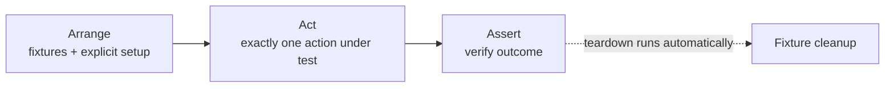

- Several `assert` lines are fine **if they all check the same behaviour**.
- Keep tests short, ideally under about 15 lines. Move repeated steps to the service layer or a fixture.
- No `if` / `for` / `try` logic in tests. Branching means you need two tests or a parametrization.

---

## 7. Fixtures

Fixtures are pytest's dependency-injection system and the backbone of a good framework.

### 7.1 Setup and teardown with `yield`

```python
@pytest.fixture
def psu(settings) -> Iterator[PowerSupply]:
    """Connected power supply with all outputs disabled on exit."""
    supply = PowerSupply.connect(settings.psu_address)
    yield supply                 # the test runs here
    supply.disable_all_outputs() # teardown always runs if setup succeeded
    supply.close()
```

> Code after `yield` runs only if the code **before** `yield` succeeded. Give each resource its
> **own fixture**, so that if acquiring resource B fails, resource A is still released.

### 7.2 Scopes

| Scope                | Created once per… | Typical use                                      |
|:---------------------|:------------------|:-------------------------------------------------|
| `function` (default) | test              | Mutable state, a freshly configured DUT          |
| `class`              | test class        | Rarely needed                                    |
| `module`             | test file         | Expensive setup shared by one feature file       |
| `package`            | test directory    | Sub-suite resources                              |
| `session`            | whole run         | Instrument connections, settings, report writers |

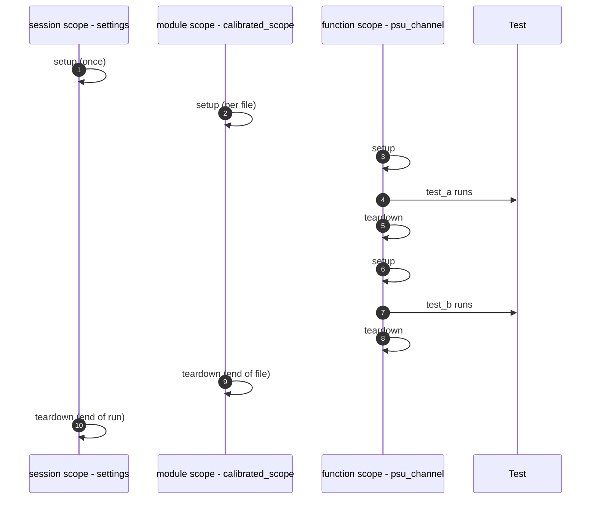

**Rules**

- A fixture can only depend on fixtures of the **same or broader** scope.
- Wider-scope fixtures must be **effectively immutable**. If tests can change their state,
  add a function-scoped fixture that resets it.

### 7.3 `conftest.py` hierarchy

A fixture in a `conftest.py` is visible to every test in that directory and below. A closer
fixture with the same name **overrides** the outer one.

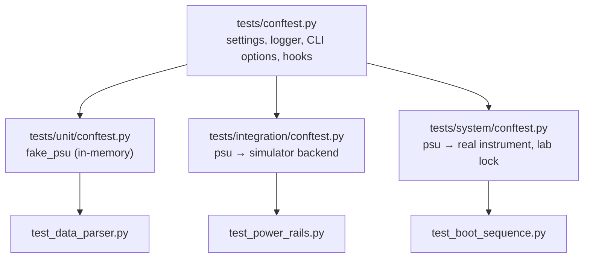

Keep `conftest.py` files **thin**: fixtures and hooks only. Put the logic they call in `src/`.

### 7.4 Fixture dependency graph

Fixtures request other fixtures, and pytest resolves the graph for you.

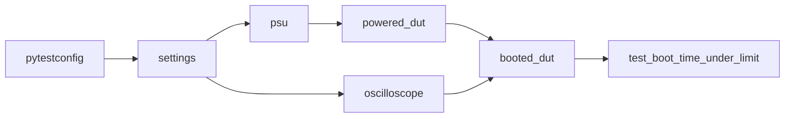

Inspect the graph with `pytest --setup-plan` (no execution) or `pytest --setup-show`.

### 7.5 Factory fixtures

When a test needs **several** or **customised** objects, return a factory function instead of an object.

```python
@pytest.fixture
def make_can_frame():
    def _make(arbitration_id: int, data: bytes = b"\x00" * 8, extended: bool = False) -> CanFrame:
        return CanFrame(arbitration_id=arbitration_id, data=data, is_extended_id=extended)
    return _make


def test_brake_frame_decodes_pedal_pressed(make_can_frame, decoder):
    frame = make_can_frame(0x1A0, data=bytes([0x01, 0, 0, 0, 0, 0, 0, 0]))
    assert decoder.decode(frame).brake_pedal_pressed is True
```

### 7.6 Parametrized fixtures

Every test that uses the fixture runs once per parameter.

```python
@pytest.fixture(params=["ch1", "ch2", "ch3"], ids=lambda ch: f"psu-{ch}")
def psu_channel(request, psu):
    return psu.channel(request.param)
```

### 7.7 Built-in fixtures worth knowing

| Fixture            | Purpose                                                               |
|:-------------------|:----------------------------------------------------------------------|
| `tmp_path`         | Unique `pathlib.Path` directory per test; no manual cleanup needed    |
| `tmp_path_factory` | Same idea for session/module-scoped fixtures                          |
| `monkeypatch`      | Temporarily patch attributes, env vars, `sys.path`, current directory |
| `caplog`           | Capture and assert on log records                                     |
| `capsys` / `capfd` | Capture stdout/stderr                                                 |
| `request`          | Information about the requesting test: params, markers, node          |
| `pytestconfig`     | Access CLI options and ini values                                     |
| `record_property`  | Attach key/value data (e.g. measurements) to the JUnit XML report     |

### 7.8 Fixture guidelines

- **Docstring every shared fixture.** `pytest --fixtures` shows it.
- **Add type hints to return values** (`-> Iterator[PowerSupply]`) so IDEs and mypy can help.
- Use `autouse=True` only for genuinely cross-cutting concerns (logging the test name, failure capture).
- Avoid fixtures that **do** things the test doesn't visibly ask for. Hidden side effects make failures hard to understand.

---

## 8. Parametrization

### 8.1 Basic, with readable IDs

```python
@pytest.mark.parametrize(
    ("rail", "nominal_v", "tolerance_v"),
    [
        pytest.param("VDD_CORE", 0.90, 0.03, id="core"),
        pytest.param("VDD_IO",   3.30, 0.10, id="io"),
        pytest.param("VDD_DDR",  1.20, 0.05, id="ddr"),
    ],
)
def test_rail_voltage_in_tolerance(booted_dut, rail, nominal_v, tolerance_v):
    assert booted_dut.measure_rail(rail) == pytest.approx(nominal_v, abs=tolerance_v)
```

The output reads `test_rail_voltage_in_tolerance[core]` instead of `[0.9-0.03-VDD_CORE]`.

### 8.2 Marks on individual cases

```python
pytest.param("VDD_AUX", 1.8, 0.05, id="aux",
             marks=pytest.mark.xfail(reason="HW-1234: AUX regulator rev A", strict=True))
```

### 8.3 Stacking produces a matrix

```python
@pytest.mark.parametrize("temperature_c", [-40, 25, 125])
@pytest.mark.parametrize("supply_v", [3.0, 3.3, 3.6])
def test_oscillator_locks(dut, temperature_c, supply_v): ...
```

|            | 3.0 V | 3.3 V | 3.6 V |
|:-----------|:-----:|:-----:|:-----:|
| **−40 °C** |   ✔   |   ✔   |   ✔   |
| **25 °C**  |   ✔   |   ✔   |   ✔   |
| **125 °C** |   ✔   |   ✔   |   ✔   |

→ 9 test cases from one function. Watch for combinatorial explosion on slow hardware tests.

### 8.4 Data-driven from files

Load external data with a **plain helper in `src/`** called at collection time, and keep the files small and versioned.

```python
LIMITS = load_limits(DATA_DIR / "rail_limits.csv")  # returns list[RailLimit]

@pytest.mark.parametrize("limit", LIMITS, ids=lambda lim: lim.rail)
def test_rail_within_limits(booted_dut, limit): ...
```

### 8.5 `indirect` parametrization

Send the parameter **through a fixture** when every value needs setup:

```python
@pytest.mark.parametrize("dut_firmware", ["v1.2.0", "v1.3.0-rc1"], indirect=True)
def test_boot_banner(dut_firmware): ...
# the dut_firmware fixture reads request.param and flashes that image
```

---

## 9. Markers & Test Selection

### 9.1 Registering and using markers

All custom markers are **registered** in config (see §4) and enforced by `--strict-markers`.

```python
@pytest.mark.smoke
@pytest.mark.hardware
def test_dut_enumerates_on_usb(booted_dut): ...
```

```bash
pytest -m smoke                       # smoke tests only
pytest -m "not hardware"              # everything that runs without a lab
pytest -m "hardware and not slow"     # quick lab check
pytest -k "rail and not ddr"          # select by name expression
```

### 9.2 Auto-skip based on environment

Skip hardware tests automatically when running against simulators, instead of relying on people
to remember the `-m` flag:

```python
def pytest_collection_modifyitems(config, items):
    if config.getoption("--env") != "sim":
        return
    skip_hw = pytest.mark.skip(reason="requires real hardware (--env=sim)")
    for item in items:
        if "hardware" in item.keywords:
            item.add_marker(skip_hw)
```

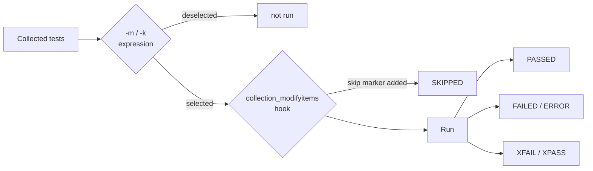

### 9.3 skip vs. xfail

| Use                  | When                                            | Example                                                |
|:---------------------|:------------------------------------------------|:-------------------------------------------------------|
| `skip` / `skipif`    | The test **cannot** run here                    | `skipif(sys.platform != "win32", reason="vendor DLL")` |
| `xfail(strict=True)` | The test runs but a **known bug** makes it fail | Linked to a ticket ID in `reason`                      |
| *(neither)*          | You're unsure if it works                       | Fix or delete the test. Don't hide it.                 |

Always give a `reason`, and include a ticket ID for xfails.

---

## 10. Assertions & Exceptions

### 10.1 Plain `assert` and introspection

pytest rewrites `assert` statements to show both sides on failure. You don't need `assertEqual` helpers.

```python
assert register_value == 0x1F            # failure shows: assert 0x1B == 0x1F
assert "READY" in status_lines           # shows the full list
assert actual_config == expected_config  # dict diff shown on failure
```

### 10.2 Floating-point / measurement comparisons

Never compare measured floats with `==`. Use `pytest.approx`:

```python
assert measured_v == pytest.approx(3.3, abs=0.05)    # absolute tolerance
assert measured_hz == pytest.approx(25e6, rel=1e-4)  # relative tolerance (100 ppm)
assert samples == pytest.approx([1.0, 2.0, 3.0], abs=0.01)
```

### 10.3 Expected exceptions

```python
def test_set_voltage_above_limit_raises(psu):
    with pytest.raises(VoltageLimitError, match=r"exceeds limit of 5\.0 V"):
        psu.set_voltage(channel=1, volts=12.0)
```

Always use `match=` or inspect `exc_info.value`. Without it, the test passes for *any* error of that type.

### 10.4 A project exception hierarchy

Raise **specific** exceptions from framework code, never bare `Exception`. Tests and fixtures can
then react precisely, and reports show meaningful error types.

```python
class LabkitError(Exception):
    """Base for all framework errors."""

class InstrumentConnectionError(LabkitError): ...
class MeasurementTimeoutError(LabkitError): ...
class VoltageLimitError(LabkitError, ValueError): ...
class ConfigurationError(LabkitError): ...
```

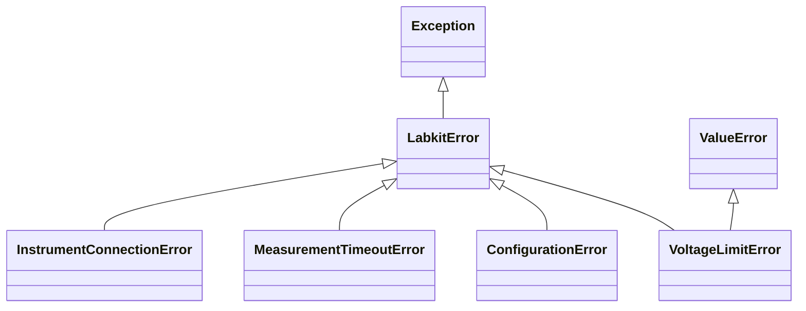

### 10.5 Custom assertion helpers

Hide helper frames from tracebacks so the failure points at the test line:

```python
def assert_rail_in_spec(measured_v: float, limit: RailLimit) -> None:
    __tracebackhide__ = True
    if not limit.min_v <= measured_v <= limit.max_v:
        pytest.fail(f"{limit.rail}: {measured_v:.3f} V outside [{limit.min_v}, {limit.max_v}] V")
```

### 10.6 Soft assertions

To report **all** failing checks in one run (useful for long hardware tests), use
`pytest-check` instead of a chain of `assert` lines that stops at the first failure.

---

## 11. The Abstraction Layer (Drivers / Adapters)

This is the hardware/API equivalent of the *Page Object Model* used in UI testing. Tests talk to
an **interface**. Concrete classes hide the vendor protocol.

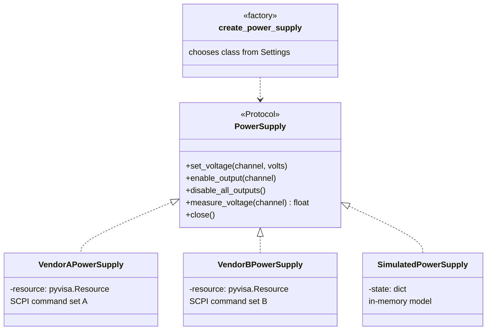

```python
class PowerSupply(Protocol):
    def set_voltage(self, channel: int, volts: float) -> None: ...
    def enable_output(self, channel: int) -> None: ...
    def measure_voltage(self, channel: int) -> float: ...
    def disable_all_outputs(self) -> None: ...
    def close(self) -> None: ...
```

```python
class VendorAPowerSupply:
    MAX_VOLTAGE_V = 30.0

    def set_voltage(self, channel: int, volts: float) -> None:
        if volts > self.MAX_VOLTAGE_V:
            raise VoltageLimitError(f"{volts} V exceeds limit of {self.MAX_VOLTAGE_V} V")
        self._write(f"INST:NSEL {channel};:VOLT {volts:.4f}")
```

**Driver guidelines**

- Methods use **domain units and names** (`volts`, `channel`), not raw protocol strings.
- Translate low-level errors (e.g. `pyvisa.errors.VisaIOError`) into project exceptions such as `InstrumentConnectionError`.
- Support the **context-manager protocol** (`with create_power_supply(cfg) as psu:`) so resources are always released.
- Log every command and response at `DEBUG`. You'll need it the first time a lab run fails at 3 a.m.
- Drivers contain **no assertions**. They report facts; tests decide pass or fail.

---

## 12. Isolation: Mock vs. Simulate vs. Real

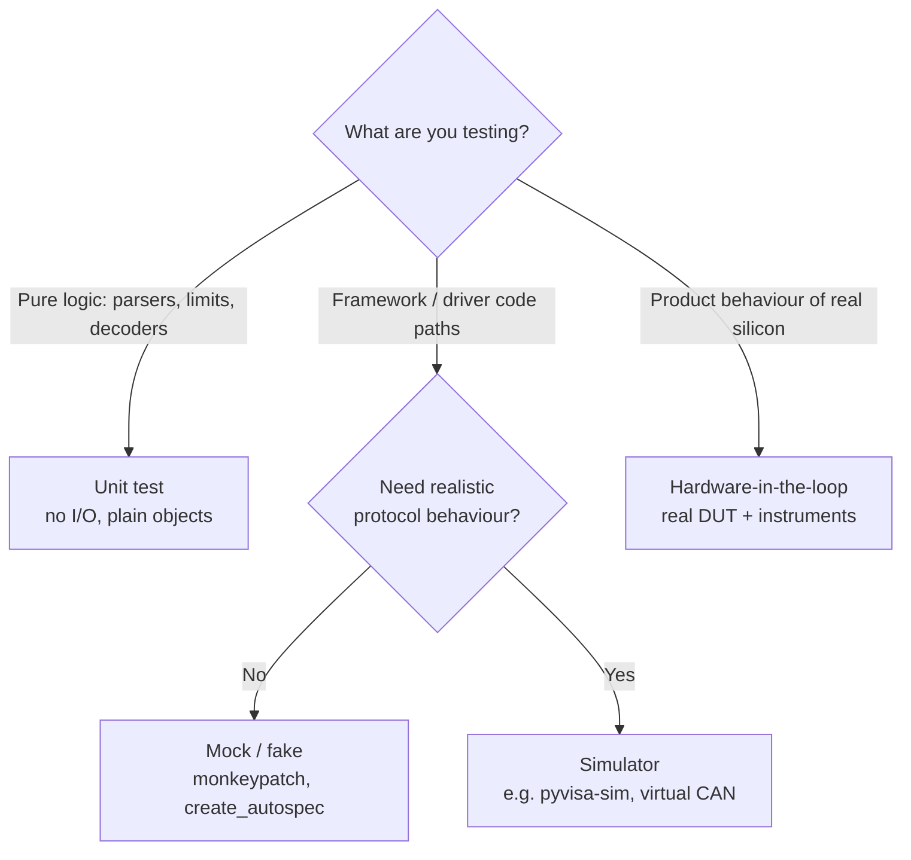

| Technique                       | Speed | Fidelity | Use for                                           |
|:--------------------------------|:-----:|:--------:|:--------------------------------------------------|
| Fake / in-memory class          | ★★★ |    ★    | Unit tests of services and logic                  |
| `unittest.mock.create_autospec` | ★★★ |    ★    | Verifying calls; autospec keeps signatures honest |
| Simulator backend               | ★★   |    ★★  | Integration tests of drivers and fixtures in CI   |
| Real hardware                   |  ★    |   ★★★ | System and acceptance tests, characterization     |

```python
def test_loader_reads_address_from_env(monkeypatch):
    monkeypatch.setenv("LABKIT_PSU_ADDRESS", "TCPIP::10.0.0.5::INSTR")
    assert load_settings("sim").psu_address == "TCPIP::10.0.0.5::INSTR"
```

```python
def test_power_up_sequence_order():
    psu = create_autospec(PowerSupply, instance=True)
    power_up_sequence(psu)
    assert psu.enable_output.call_args_list == [call(channel=1), call(channel=2), call(channel=3)]
```

> **Don't over-mock.** If a test mocks everything below the function under test, it only tests
> the mock setup. Prefer fakes and simulators at the boundary, and mock only what you don't own.

---

## 13. Environments & Command-Line Options

### 13.1 Precedence

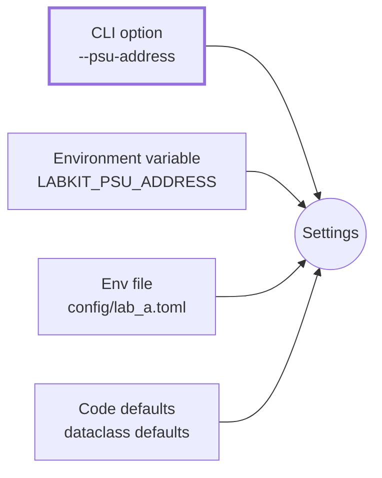

**Highest wins: CLI → env var → env file → defaults.** Secrets (tokens, passwords) come from
environment variables or a secret store and are **never** committed.

### 13.2 Typed settings object

```python
@dataclass(frozen=True)
class Settings:
    env: str
    psu_address: str
    scope_address: str
    io_timeout_s: float = 5.0
    report_dir: Path = Path("reports")
```

A frozen dataclass (or a `pydantic` model) gives one validated object instead of string lookups like
`config.get("URLS", "base_url")` scattered across fixtures.

### 13.3 Declaring options

```python
ENVIRONMENTS = ("sim", "lab_a", "lab_b")

def pytest_addoption(parser):
    group = parser.getgroup("labkit", "Lab test framework options")
    group.addoption("--env", default="sim", choices=ENVIRONMENTS,
                    help="target environment (default: sim)")
    group.addoption("--psu-address", default=None,
                    help="override PSU VISA resource string")
```

```python
@pytest.fixture(scope="session")
def settings(pytestconfig) -> Settings:
    try:
        return load_settings(
            env=pytestconfig.getoption("--env"),
            overrides={"psu_address": pytestconfig.getoption("--psu-address")},
        )
    except ConfigurationError as err:
        raise pytest.UsageError(str(err)) from err
```

- Use `choices=` so invalid values fail **before** any test runs.
- Options that take structured input (JSON, lists) should be parsed and validated in **one** place, with a clear error. Handle a missing value too.
- Log the effective settings at session start (§15) so every report says what it ran against.

---

## 14. Hooks & Plugins

### 14.1 The pytest run lifecycle

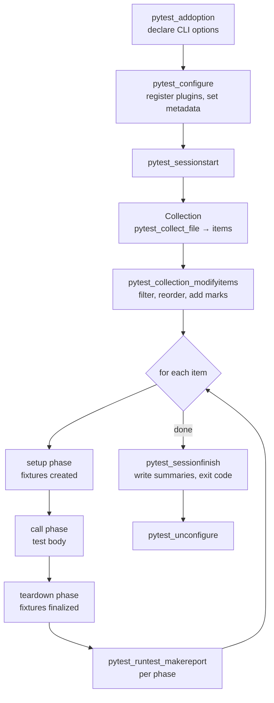

### 14.2 Commonly used hooks

| Hook                            | Typical use                                              |
|:--------------------------------|:---------------------------------------------------------|
| `pytest_addoption`              | Custom CLI options                                       |
| `pytest_configure`              | Register markers dynamically, add report metadata        |
| `pytest_collection_modifyitems` | Auto-skip, auto-mark by folder, reorder                  |
| `pytest_runtest_makereport`     | Capture pass/fail per phase, attach artifacts on failure |
| `pytest_sessionfinish`          | Export summary (CSV/Excel), release lab locks            |
| `pytest_html_report_title`      | Customize pytest-html report                             |

### 14.3 Acting on failure inside a fixture

The canonical pattern stores each phase's report on the test item so fixtures can see whether the test failed:

```python
PHASE_REPORT_KEY = pytest.StashKey[dict[str, pytest.TestReport]]()

@pytest.hookimpl(wrapper=True, tryfirst=True)
def pytest_runtest_makereport(item, call):
    report = yield
    item.stash.setdefault(PHASE_REPORT_KEY, {})[report.when] = report
    return report
```

```python
@pytest.fixture
def dut_diagnostics_on_failure(request, booted_dut, tmp_path):
    yield
    reports = request.node.stash.get(PHASE_REPORT_KEY, {})
    if "call" in reports and reports["call"].failed:
        booted_dut.dump_registers(tmp_path / "registers.txt")
        booted_dut.save_uart_log(tmp_path / "uart.log")
```

### 14.4 Growing into a plugin

When `conftest.py` files across repositories start to duplicate each other, extract a plugin:

```toml
[project.entry-points.pytest11]
labkit = "labkit.pytest_plugin"
```

Installing the package then activates the fixtures, options and hooks in every project that depends on it.

---

## 15. Logging & Reporting

### 15.1 Logging, not printing

```python
LOGGER = logging.getLogger(__name__)

def measure_voltage(self, channel: int) -> float:
    response = self._query(f"MEAS:VOLT? (@{channel})")
    LOGGER.debug("ch%d voltage raw=%r", channel, response)
    return float(response)
```

- `print()` output is captured and easily lost. `logging` has levels, timestamps and logger names.
- pytest captures logs per test and shows them **only for failures**. Turn on live logs with `--log-cli-level=INFO`.
- Assert on logs with `caplog`:

```python
def test_retry_is_logged(caplog, flaky_link):
    with caplog.at_level(logging.WARNING, logger="labkit.drivers"):
        flaky_link.read_with_retry()
    assert "retrying" in caplog.text
```

### 15.2 Report pipeline

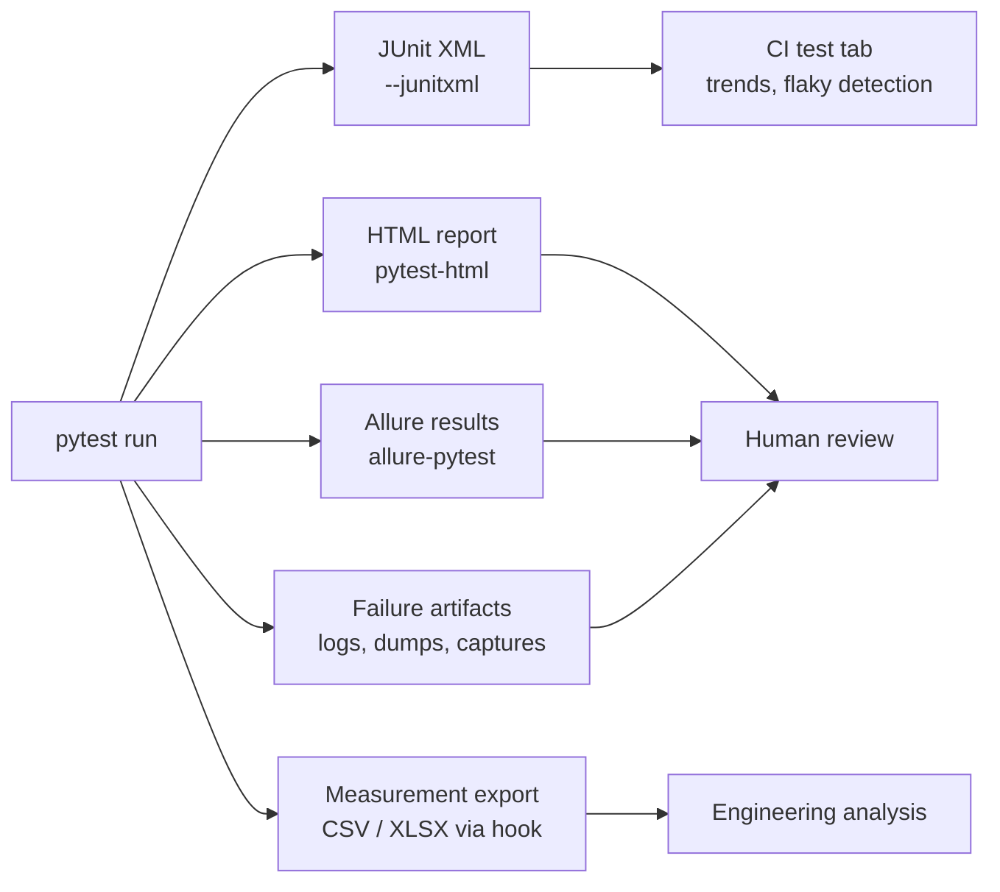

| Output                | Audience                 | How                                                  |
|:----------------------|:-------------------------|:-----------------------------------------------------|
| Console `-ra` summary | Developer                | Built in                                             |
| JUnit XML             | CI systems               | `--junitxml=reports/junit.xml`                       |
| HTML                  | Humans, attachments      | `pytest-html`, `--self-contained-html`               |
| Allure                | Rich dashboards, history | `allure-pytest`                                      |
| Measurement data      | Engineers                | `record_property` + export in `pytest_sessionfinish` |

```python
def test_boot_time_under_limit(booted_dut, record_property):
    boot_ms = booted_dut.last_boot_duration_ms()
    record_property("boot_time_ms", boot_ms)   # appears in JUnit XML
    assert boot_ms < 800
```

**Report paths:** build them from settings or the run timestamp, relative to the project
(e.g. `reports/2026-10-30_142233/`). Never hard-code machine-specific absolute paths in config.

---

## 16. Reliability: Waits, Timeouts, Flakiness, Ordering

### 16.1 Poll, don't sleep

```python
def wait_until(predicate: Callable[[], bool], timeout_s: float, interval_s: float = 0.1,
               description: str = "condition") -> None:
    deadline = time.monotonic() + timeout_s
    while time.monotonic() < deadline:
        if predicate():
            return
        time.sleep(interval_s)
    raise MeasurementTimeoutError(f"Timed out after {timeout_s}s waiting for {description}")
```

```python
wait_until(lambda: dut.read_status() == "READY", timeout_s=5, description="DUT READY")
```

| `time.sleep(5)`                      | `wait_until(..., timeout_s=5)`         |
|:-------------------------------------|:---------------------------------------|
| Always takes 5 s                     | Returns as soon as the condition holds |
| Fails randomly if the device is slow | Fails with a clear timeout message     |
| Hides what you're waiting for        | Documents the expected state           |

### 16.2 Timeouts

Set a global `timeout` (pytest-timeout) plus explicit I/O timeouts in drivers. A hung instrument
should fail one test, not block the whole nightly run.

### 16.3 Flaky tests

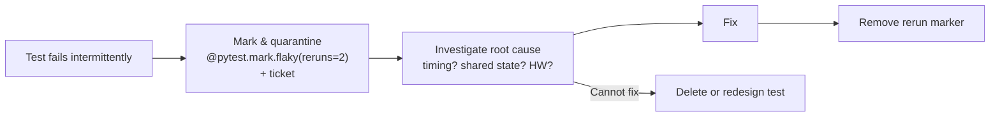

- Use reruns (`pytest-rerunfailures`) **per test, temporarily, with a ticket**, never as a global `--reruns 3`.
- A test that passes on rerun still needs a root-cause fix.

### 16.4 Ordering and independence

- Tests must not depend on execution order. Run `pytest-randomly` (or `-p random_order`) in CI to expose hidden coupling.
- If hardware genuinely requires a sequence (flash → boot → test), express it with **fixtures**
  (`flashed_dut` → `booted_dut`), not with `pytest-order` numbers.
- Seed any randomness you use, and log the seed.

---

## 17. Parallel Execution

`pytest-xdist` runs tests in multiple worker processes: `pytest -n auto`.

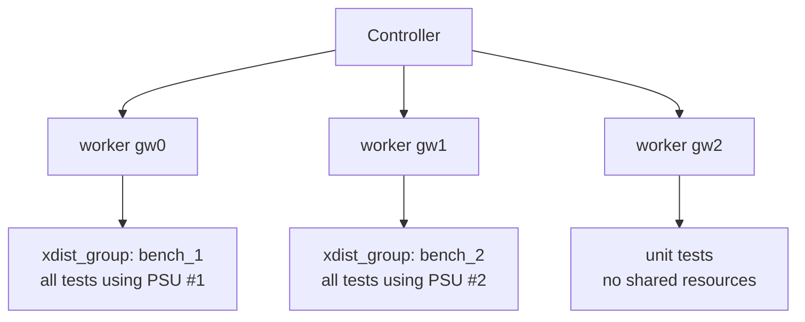

```python
@pytest.mark.xdist_group(name="bench_1")
def test_rail_sequence_bench_1(...): ...
```

```bash
pytest -n 3 --dist loadgroup
```

**Watch out**

- **Session fixtures run once per worker**, not once per run. Shared physical resources need
  grouping (`--dist loadgroup`), a lock (e.g. `filelock`), or one bench per worker.
- `tmp_path` is already unique per worker. Your own output files must be too, e.g. include
  `worker_id` (a fixture provided by xdist) in the filename.
- Pure unit tests are the easiest to parallelize. Get them parallel first.

---

## 18. Code Quality Tooling

Test code is production code for your quality process. Hold it to the same standard.

| Tool                   | Role                                                                                       |
|:-----------------------|:-------------------------------------------------------------------------------------------|
| **ruff**               | Linting + formatting (replaces flake8, isort, black); includes `PT` rules for pytest style |
| **mypy** / **pyright** | Static typing of framework code and fixtures                                               |
| **pre-commit**         | Runs the above before every commit                                                         |

```toml
[tool.ruff]
line-length = 110
target-version = "py311"

[tool.ruff.lint]
select = ["E", "F", "I", "B", "UP", "PT", "N", "SIM"]
```

```yaml
# .pre-commit-config.yaml (excerpt)
repos:
  - repo: https://github.com/astral-sh/ruff-pre-commit
    rev: v0.6.9
    hooks:
      - id: ruff
        args: [--fix]
      - id: ruff-format
```

The `PT` ruleset flags common pytest mistakes: `pytest.raises` without `match`, wrong
parametrize argument types, fixtures with unnecessary parentheses, and so on.

---

## 19. CI/CD Integration

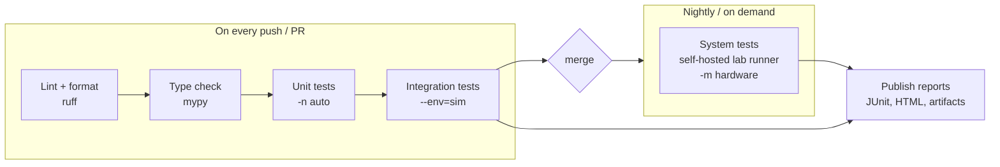

```yaml
# GitHub Actions excerpt
jobs:
  test-sim:
    runs-on: ubuntu-latest
    steps:
      - uses: actions/checkout@v4
      - uses: actions/setup-python@v5
        with: { python-version: "3.12" }
      - run: pip install -e ".[test]"
      - run: pytest -m "not hardware" -n auto --junitxml=reports/junit.xml
      - uses: actions/upload-artifact@v4
        if: always()
        with: { name: reports, path: reports/ }

  test-hil:
    runs-on: [self-hosted, lab-bench-1]
    if: github.event_name == 'schedule'
    steps:
      - run: pytest -m hardware --env=lab_a --junitxml=reports/junit-hil.xml
```

- Upload reports with `if: always()` so failures still produce artifacts.
- Run lab jobs on **labelled self-hosted runners** with limited concurrency, so two pipelines never share a bench.
- The **exit code** is the contract: 0 = pass, 1 = test failures, 2 = interrupted, 3 = internal error, 4 = usage error, 5 = no tests collected.

---

## 20. Suite Strategy: The Test Pyramid

```text
                    ▲  slower, costlier, higher fidelity
                   ╱ ╲
                  ╱   ╲        SYSTEM / HIL
                 ╱ few ╲       real DUT + instruments · nightly
                ╱───────╲
               ╱         ╲     INTEGRATION
              ╱  some     ╲    drivers + fixtures vs simulators · every PR
             ╱─────────────╲
            ╱               ╲  UNIT
           ╱      many       ╲ parsers, limits, decoders, services · every commit
          ╱───────────────────╲
                    ▼  faster, cheaper, run more often
```

| Level             | Share of tests (guide) | Runtime target | Runs                   |
|:------------------|:----------------------:|:---------------|:-----------------------|
| Unit              |         ~70 %          | < 10 ms each   | Every save / commit    |
| Integration (sim) |         ~20 %          | < 1 s each     | Every PR               |
| System (HIL)      |         ~10 %          | minutes        | Nightly, release gates |

Push every check as far **down** the pyramid as it can go. A limit-calculation bug should be caught
by a unit test in milliseconds, not by a 20-minute lab run.

---

## 21. CLI Cheat Sheet

| Command                                                              | Purpose                                         |
|:---------------------------------------------------------------------|:------------------------------------------------|
| `pytest -x`                                                          | Stop at first failure                           |
| `pytest --lf` / `--ff`                                               | Re-run last failures only / run them first      |
| `pytest -k "rail and not ddr"`                                       | Select by name expression                       |
| `pytest -m "smoke and not hardware"`                                 | Select by marker expression                     |
| `pytest tests/integration/test_power_rails.py::TestRails::test_core` | Run one test                                    |
| `pytest -v -ra`                                                      | Verbose + summary of non-passing outcomes       |
| `pytest --collect-only -q`                                           | List tests without running                      |
| `pytest --fixtures`                                                  | List available fixtures with docstrings         |
| `pytest --setup-show`                                                | Show fixture setup/teardown order while running |
| `pytest --durations=10`                                              | Show the 10 slowest tests                       |
| `pytest --log-cli-level=DEBUG`                                       | Live logs to console                            |
| `pytest --pdb`                                                       | Drop into the debugger on failure               |
| `pytest -n auto`                                                     | Parallel (pytest-xdist)                         |
| `pytest --junitxml=reports/junit.xml`                                | Machine-readable results                        |

---

## 22. Recommended Plugins

| Plugin                 | Purpose                                 | Notes                                |
|:-----------------------|:----------------------------------------|:-------------------------------------|
| `pytest-xdist`         | Parallel execution                      | `-n auto`, `--dist loadgroup`        |
| `pytest-timeout`       | Kill hung tests                         | Essential with I/O and hardware      |
| `pytest-html`          | Self-contained HTML report              | Good for sharing with non-developers |
| `allure-pytest`        | Rich reporting with history             | Needs Allure server/CLI              |
| `pytest-rerunfailures` | Rerun flaky tests                       | Per-test, temporary, with a ticket   |
| `pytest-randomly`      | Randomize order, seed RNGs              | Exposes inter-test dependencies      |
| `pytest-check`         | Soft assertions                         | Report all failed checks at once     |
| `pytest-cov`           | Coverage of framework code              | Useful for the `src/` library itself |
| `pytest-mock`          | `mocker` fixture around `unittest.mock` | Auto-undo of patches                 |
| `pytest-benchmark`     | Performance regression tests            | For timing-sensitive code            |
| `pyvisa-sim`           | Simulated VISA instruments              | Domain-specific: CI without a lab    |

Add plugins deliberately. Each one changes collection or reporting behaviour and has to be maintained across upgrades.

---

## 23. Anti-Patterns

| Anti-pattern                                            | Why it hurts                             | Do instead                                        |
|:--------------------------------------------------------|:-----------------------------------------|:--------------------------------------------------|
| `time.sleep()` to wait for hardware                     | Slow *and* flaky                         | `wait_until()` polling with timeout               |
| Tests depend on run order                               | Breaks on `-k`, parallel runs and reruns | Express prerequisites as fixtures                 |
| Hard-coded paths, IPs, VISA addresses                   | Works on one machine only                | Settings object + env files + CLI options         |
| Copy-pasted framework from another domain               | Dead fixtures, wrong defaults, confusion | Start minimal; add what the domain needs          |
| Giant `conftest.py` with logic                          | Untestable, hard to navigate             | Logic in `src/`, thin fixtures                    |
| `except Exception: pass` in fixtures                    | Hides real failures                      | Catch specific exceptions; let others fail        |
| Raising bare `Exception`                                | Callers can't distinguish errors         | Project exception hierarchy                       |
| `assert x == True`, `assert len(y) > 0` without context | Weak failure messages                    | `assert x is True`, `assert y, "expected frames"` |
| `pytest.raises(Error)` without `match`                  | Passes for the wrong reason              | `match=` or inspect `exc_info.value`              |
| Global `--reruns 3`                                     | Masks real defects                       | Targeted `flaky` marker + ticket                  |
| Unregistered markers                                    | Typos silently select nothing            | `--strict-markers`                                |
| Tests with `if/else` or loops                           | Unclear which case failed                | Parametrize                                       |
| Session fixtures with mutable state                     | Cross-test contamination                 | Reset in a function-scoped fixture                |
| `print()` debugging                                     | Lost output, no levels                   | `logging` + `caplog`                              |
| Untracked source / no commits                           | Work lost permanently                    | Commit early and often                            |

---

## 24. Review Checklist

**Structure**

- [ ] `src/` package installed with `pip install -e .`; tests separated into unit / integration / system
- [ ] One config file (`pyproject.toml`) with `testpaths`, `--strict-markers`, `--strict-config`, `xfail_strict`
- [ ] Dependencies pinned in a lock file (UTF-8)

**Tests**

- [ ] Names describe behaviour; Arrange-Act-Assert; one behaviour per test
- [ ] No sleeps, branching or loops in test bodies
- [ ] Floats compared with `pytest.approx`; `pytest.raises` uses `match`
- [ ] Parametrized cases have readable `id`s

**Fixtures**

- [ ] One resource per fixture, `yield` teardown, docstring, type hints
- [ ] Narrowest scope that's fast enough; wide-scope fixtures are immutable
- [ ] `autouse` only for cross-cutting concerns

**Framework**

- [ ] Device/API access only through adapter classes
- [ ] Project-specific exception hierarchy; no bare `Exception`
- [ ] Settings are typed, validated once and logged at session start
- [ ] Simulator backend available, so the full suite runs without a lab

**Operations**

- [ ] Global timeout set; flaky tests quarantined with tickets
- [ ] JUnit XML + human-readable report produced; artifacts saved on failure
- [ ] CI: lint → types → unit → sim on every PR; HIL on schedule
- [ ] Order independence checked (`pytest-randomly`)

---

## 25. References

- pytest: Good Integration Practices: <https://docs.pytest.org/en/stable/explanation/goodpractices.html>
- pytest: How to use fixtures: <https://docs.pytest.org/en/stable/how-to/fixtures.html>
- pytest: Parametrizing tests: <https://docs.pytest.org/en/stable/how-to/parametrize.html>
- pytest: Working with custom markers: <https://docs.pytest.org/en/stable/how-to/mark.html>
- pytest: Writing hook functions: <https://docs.pytest.org/en/stable/how-to/writing_hook_functions.html>
- pytest: API reference (hooks, config options): <https://docs.pytest.org/en/stable/reference/reference.html>
- pytest: Plugin list: <https://docs.pytest.org/en/stable/reference/plugin_list.html>
- pytest-xdist: <https://pytest-xdist.readthedocs.io/>
- Ruff pytest rules (`PT`): <https://docs.astral.sh/ruff/rules/#flake8-pytest-style-pt>
- PyVISA-sim: <https://pyvisa.readthedocs.io/projects/pyvisa-sim/>
