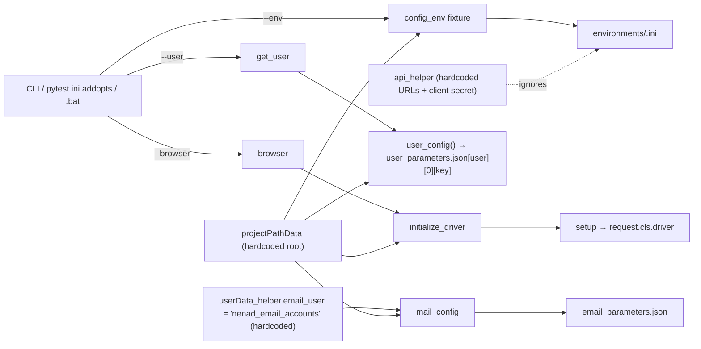

# SND Portal Test Automation Framework: Analysis Report

**Scope:** `snd_portal` repository (branch `develop`, commit `8b1de62`)
**Method:** static review of all framework code, configuration, page objects, helpers and a representative sample of the 133 test modules. Tests were not executed: importing the framework creates directories under a hardcoded `c:\sindri_automation\...` path and the tests drive live environments.
**Date:** 2026-10-27

> Secrets found during the review are referenced by location only and are not reproduced in this report.

---

## 1. Executive summary

The repository is a Selenium/pytest UI automation suite for the Sindri Web Portal. It also contains auxiliary helpers for REST/OAuth2, Gmail, PDF/Excel reporting, and Windows/hardware tooling: a serial PSU, a serial trace reader, CANSimulator, the VCI Flashloader and PuTTY. It follows the Page Object Model with a shared `BasePage` and a `BaseTest` that injects a WebDriver through a fixture.

The framework works for its authors' machines. Its main limitations are **environment coupling, secrets management, and test isolation**, not missing features:

| # | Key finding                                                                                                             | Severity     |
|:--|:------------------------------------------------------------------------------------------------------------------------|:-------------|
| 1 | Plaintext credentials, an OAuth client secret and live tokens are committed to git                                      | **Critical** |
| 2 | All paths resolve to a hardcoded `c:\sindri_automation\Sindri-WebPortal-Automation` root, not the checkout location     | **High**     |
| 3 | The failure-screenshot hook crashes with `KeyError` for any failing test that does not use a browser                    | **High**     |
| 4 | Test cleanup is inline in the test body, so it is skipped on failure; tests share live environment state                | **High**     |
| 5 | Logging is configured in 10 page classes but never used (0 log calls in pages and tests); handlers are added repeatedly | **Medium**   |
| 6 | Hardware helpers open serial ports, or run an infinite read loop, **when imported**                                     | **High**     |
| 7 | 352 `try/except Exception: raise Exception("…")` wrappers replace specific Selenium errors with generic ones            | **Medium**   |

**Maturity: Level 2 (Basic)**, approaching Level 3 in the UI layer (see §8).

---

## 2. Framework architecture

```
snd_portal/
├── conftest.py            # driver factory, CLI options, config/user fixtures, HTML-report hook
├── pytest.ini             # markers, logging, addopts (HTML report path, --env)
├── environments/*.ini     # per-env URLs + accounts (cicd, cicd_api, dev, vv)
├── resources/
│   ├── projectPathData.py # global path constants (hardcoded root), creates dirs on import
│   ├── oauth2_credentials.json,  # users, passwords, mail accounts
│   └── user_data/*.json   # users, passwords, mail accounts
├── pages/                 # POM: BasePage + 10 page classes (~4.6k LOC)
├── helpers/               # API, email, PDF, data, PSU, serial, CanSim, PuTTY, Flashloader (~2.3k LOC)
├── tests/                 # 133 test_* modules grouped by feature + sand_box, reporting, email
└── cicd/*.bat             # 3 near-identical Windows launchers (env differs)
```

**Strengths**
- The POM is applied consistently. Locators are private class constants (`__USERNAME = (By.XPATH, …)`), and `BasePage` centralises explicit waits ([pages/BasePage.py:53-300](pages/BasePage.py#L53)).
- The test tree mirrors functional areas (billing, licence, customer and user management) and test names map to Jira IDs (`test_sindri_<ID>_…`), which gives traceability.
- Markers are declared in `pytest.ini`, so suites can be selected (`-m smoke`, `-m billing`).

**Weaknesses**
- **No package or install boundary.** Modules rely on `from resources.projectPathData import *` and the working directory. There is no `pyproject.toml` or `setup.cfg`, so imports only work when run from the root.
- **Mixed responsibilities in `helpers/`.** Web-API, email and reporting helpers sit alongside Windows GUI and hardware drivers that the web tests never use. A unit of hardware code (`psu_helper_old.PSU`) even inherits from the test base class (§5).
- **Dead or experimental code ships with production tests.** This includes `psu_helper_old.py`, `tests/sand_box/` (whose `test_sindri_*` files **are collected** by `python_files = test_*`), `*-TODO.py` tests, `test_sindri_SIMILAR_TO_11802_*`, and large commented-out blocks in `conftest.py` and `pytest.ini`.
- **Dependencies are outdated and have redundancies** ([requirements.txt](requirements.txt)). It pins `selenium==3.141.0` and `pytest==6.2.4`, and includes both `pytest-xdist` and `pytest-parallel`, plus `nose`, `self`, `bs4` (a dummy wrapper of `beautifulsoup4`), `sphinx` and `HTMLParser`, which do not appear to be used. `webdriver-manager` is pinned but not used in `conftest.py`.

---

## 3. Logging and reporting

### Logging
- `getLogger()` ([pages/BasePage.py:15-40](pages/BasePage.py#L15)) configures the **root** logger, adding a new `FileHandler` and `StreamHandler` on **every call**. Ten page constructors call it (`self.log = getLogger()`), so a test with six page objects gets six duplicate handlers. Each log line would then be written six times, and handlers accumulate across the whole session.
- **`self.log` is never used.** There are 0 `self.log.*` calls in `pages/` or `tests/`. Only `canSim_helper` and `putty_helper` call `logging.info/warning`. In practice the suite produces no diagnostic log.
- The log file name differs depending on whether the directory existed (`logfile_` vs `logfile`, [BasePage.py:20-24](pages/BasePage.py#L20)). The timestamp is computed at import time, so all runs in one process share one file.
- `pytest.ini` sets `log_cli=true` and `log_format`, but every `log_level` line is commented out. This config and `getLogger()` are two competing mechanisms.
- Helpers use `print()` for errors (`email_helper`, `canSim_helper`, `excel_webPortal_reporter`). With pytest capture enabled, these messages only appear for failing tests.

### Reporting
- `pytest-html` uses a self-contained report and a custom title ([conftest.py:173-175](conftest.py#L173)), and a screenshot is embedded on failure ([conftest.py:177-194](conftest.py#L177)). This is good practice.
- **Defect: the hook assumes a browser.** `item.funcargs['initialize_driver']` ([conftest.py:187](conftest.py#L187)) raises `KeyError` for any failing test that does not request the driver (API tests, email tests, `CustomerManage`). This turns a normal failure into an INTERNALERROR in the hook.
- The screenshot HTML is malformed (`height=200ph`, nested unescaped quotes in `onclick`), so the click-to-enlarge does not work.
- The current URL, page source and browser console logs are not attached, which would make UI failures much easier to diagnose.
- The report path is absolute and machine-specific: `--html=c:/sindri_automation/Sindri-WebPortal-Automation/reports/...` ([pytest.ini:30](pytest.ini#L30)).
- Post-processing (`tests/reporting/excel_webPortal_reporter.py`, `tests/email_tests/*`) is implemented as ad hoc scripts. The e-mail "tests" `sleep(10)` and attach a hardcoded path (`c:\sindri_automation\sindri_webPortal\...`) that **differs** from the path in `pytest.ini`. No JUnit XML is produced for CI.

---

## 4. Configuration, `conftest.py` and fixtures

### Parameter flow



### Findings
| Issue                                                                                                                                                                                             | Location                                                                 | Impact                                                                                                                                                                                                                                      |
|:--------------------------------------------------------------------------------------------------------------------------------------------------------------------------------------------------|:-------------------------------------------------------------------------|:--------------------------------------------------------------------------------------------------------------------------------------------------------------------------------------------------------------------------------------------|
| **Hardcoded project root.** `project_root_path = Path("c:\\sindri_automation\\Sindri-WebPortal-Automation")` (with similar fixed paths for macOS and Linux)                                       | [resources/projectPathData.py:6-18](resources/projectPathData.py#L6)     | The checkout at `C:\Build\pytest_sandbox\snd_portal` reads its `.ini` and JSON files from a *different* directory, or from none. `configparser.read()` silently ignores missing files, so the result is a late `NoSectionError` in `setup`. |
| **Import-time side effects.** The module creates `reports/*` and `test_data` directories and `print`s the OS on import                                                                            | [projectPathData.py:35-61](resources/projectPathData.py#L35)             | Every import writes to disk.                                                                                                                                                                                                                |
| **`--env` default is overridden.** `addoption` defaults to `cicd`, but `pytest.ini` addopts forces `--env=vv`                                                                                     | [conftest.py:105-110](conftest.py#L105), [pytest.ini:45](pytest.ini#L45) | The effective default is not what the help text says.                                                                                                                                                                                       |
| **The `--user` option is ignored for e-mail.** The mail account is fixed by `email_user = "nenad_email_accounts"`. `[User_Data]` in `vv.ini` is never read                                        | [helpers/userData_helper.py:7](helpers/userData_helper.py#L7)            | Jenkins and other users still poll one developer's mailbox.                                                                                                                                                                                 |
| **The API layer bypasses configuration.** OAuth URLs, the redirect URI and the client secret are hardcoded, so the `[APIAuthorization]`/`[VVApi]` sections are dead config                        | [helpers/api_helper.py:47-48, 113](helpers/api_helper.py#L47)            | Switching `--env` does not switch the API target.                                                                                                                                                                                           |
| **`input_parameters` crashes when the option is absent.** `None.replace(...)` raises; `"to do"` help text                                                                                         | [conftest.py:146-148](conftest.py#L146)                                  | `AttributeError` in any test that requests the fixture without the flag.                                                                                                                                                                    |
| **`user_config` re-reads JSON on every lookup.** It contains a loop that always returns at `i=0`                                                                                                  | [conftest.py:160-170](conftest.py#L160)                                  | Repeated file I/O. Unknown keys raise a raw `KeyError` with no context.                                                                                                                                                                     |
| **Driver lifecycle split across two fixtures.** `initialize_driver` *returns* without teardown, and `setup` quits. If `maximize_window()`/`get()` fails before `yield`, the browser is never quit | [conftest.py:14-23, 26-101](conftest.py#L14)                             | Browser and driver processes leak, typically on CI agents.                                                                                                                                                                                  |
| **Unsupported browser aliases are rejected early.** The `"Firefox"`/`"ff"` branches are unreachable after the whitelist check, and edge/ie/safari ignore all options                              | [conftest.py:32, 92](conftest.py#L32)                                    | Dead branches and inconsistent browser setup.                                                                                                                                                                                               |
| **`implicitly_wait(1)` combined with explicit waits**                                                                                                                                             | [conftest.py:100](conftest.py#L100)                                      | Mixing both causes unpredictable wait durations, which Selenium documents as unsupported.                                                                                                                                                   |
| **Function-scoped config fixtures** (`config_env`, `user_config`)                                                                                                                                 | conftest                                                                 | Minor. Config is re-parsed per test; `session` scope is appropriate.                                                                                                                                                                        |
| **CI launchers.** 3 copies differing by one line; `WEBPORTAL_LOCATION=c:\sindri_automation\sindri_webPortal` (a third path variant); always `exit /b 0`                                           | [cicd/*.bat](cicd/webPortal_pytest_launcher_VV.bat)                      | CI cannot detect test failures from the exit code.                                                                                                                                                                                          |

---

## 5. OOP and coding practices

**Positive**
- `BasePage` encapsulates WebDriver primitives, and pages expose intention-revealing methods (`create_licence`, `delete_technician`).
- Locators use name-mangled private constants, which keeps them out of tests.
- The older `PSU` design (context manager, `NamedTuple` readings, properties) is a reasonable driver abstraction, but it is unused.

**Issues**
1. **Generic exception wrapping (352 occurrences in `pages/`).** For example:
   ```python
   try:
       self._input(text, *self.__USERNAME)
   except Exception:
       raise Exception("Login dialog - User name editbox is not populated")
   ```
   This discards the exception type (`TimeoutException`, `StaleElementReferenceException`, …) and makes `pytest.raises` or targeted retries impossible. The original traceback survives only as implicit context. **Recommendation:** remove the wrappers, or raise a custom `PageActionError(...) from e` from a single `BasePage` helper.
2. **Assertions and flow switches as positional booleans.** Calls like `create_new_technician_random(None, True)` and `allocate_user_to_non_resale_licence(lic, tech, True)` need comments to be read, and they put verification inside page objects (11 `assert`s in `pages/`). Use keyword-only arguments, and keep assertions in tests or in dedicated `verify_*` methods.
3. **Pages instantiate other pages internally**, for example `CustomerManagementPage` creates `LoginPage`, `TopMenuPage`, `SideMenuPage` and `UserManagementPage` inside methods ([pages/customerManagementPage.py:349-408, 852-944](pages/customerManagementPage.py#L349)). This hides workflow orchestration in a page and creates tight coupling. Move multi-page flows into a "steps/flows" layer or fixtures.
4. **State passed through attributes.** Tests read generated data back via side-effect attributes (`licenceManagement_page.random_licence_description`, `userManagement_page.newUserFirstName`). Methods should return the created entity instead.
5. **Inappropriate inheritance.** `class PSU(BaseTest)` ([helpers/psu_helper_old.py:17](helpers/psu_helper_old.py#L17)) makes a hardware driver a pytest test base (with `usefixtures("setup")`). It also imports `conftest` directly (line 5), which pytest discourages.
6. **Duplication.**
   - `api_authorization_clm/admin/super_admin` are three ~93-line copies that differ only in two credential keys ([api_helper.py:42, 135, 228](helpers/api_helper.py#L42)).
   - `get_device_ports` is copied between `psu_helper` and `serial_helper`, as is `killCanSimProcess` between the two CanSim helpers.
   - The 3 `.bat` files are near-identical.
   - 10 test function names are duplicated across files (e.g. `test_9506_edit_a_vehicle_checklist`, `test_13323_…`).
7. **Hardcoded sleeps in the wait layer.** `_get_element_value/_title/_text` each `time.sleep(1)` *before* an explicit wait ([BasePage.py:99, 114, 129](pages/BasePage.py#L99)). There are 58 `time.sleep` calls across `pages/`. This adds seconds per test and masks real synchronisation issues.
8. **Naming and style.** The code mixes `camelCase`, `snake_case` and `PascalCase` module names (`BasePage.py`, `loginPage.py`, `canSim_helper.py`). It uses wildcard imports, `from _datetime import datetime` (a private CPython module) and docstrings used as inline comments (`""" Login as Admin """`). Type hints are near-absent, apart from `BasePage._open_page/_input` and `psu_helper_old`.
9. **Fragile parsing.**
   - The OAuth flow parses `Set-Cookie` and `Location` by manual `split()`, assuming cookie order ([api_helper.py:64-107](helpers/api_helper.py#L64)).
   - Form bodies are built by string concatenation without URL-encoding, so passwords containing `&`, `+` or `=` break login.
   - `_scroll_to_element` ends in a bare `raise Exception` after a 600 s busy loop ([BasePage.py:293-303](pages/BasePage.py#L293)).

---

## 6. Test reliability and hardware automation

### Test organisation and isolation
- **Cleanup is inline and skipped on failure.** For example, [test_sindri_4877…py:65-70](tests/licence_management/test_sindri_4877_CLM_allocate_new_technician_to_licence.py#L65) deletes the technician as the last test step. Any earlier failure leaves orphaned users, licences and customers in the shared VV/CICD environment. Whole `performance_tests/*delete*` modules exist to sweep this up. There are **0** yield fixtures or finalizers under `tests/`.
- **Cross-test file state.** Billing tests write and read `resources/test_data/*.json` through `json_create/json_addKey/json_reader` (e.g. [test_sindri_5558…py:56-179](tests/billing/test_sindri_5558_Conti_Admin_see_billing_details_and_report_detailed_breakdown.py#L56)), and downloads go to one shared `reports/pdf_reports`. These tests are **unsafe under `pytest-xdist`**, which is listed in requirements.
- **Ordering dependence.** 111 `@pytest.mark.order` markers exist. Most tests are self-contained, but the explicit ordering suggests reliance on environment state built by earlier tests.
- **Shared accounts.** Every test logs in as the same CLM/admin accounts, and each test creates entities in that account. Concurrent runs (several users, Jenkins) interfere with each other.
- **Random collisions.** Generated names use `random.randint(1000, 7000)` for SAP numbers, contract numbers, sales IDs and checklist names ([customerManagementPage.py:185-204](pages/customerManagementPage.py#L185), [helpers/randomData_helper.py](helpers/randomData_helper.py)). The space of ~6k values collides with leftover data from failed runs, which is likely given the inline-cleanup issue above.
- **Uncollected test.** `class CustomerManage` does not match `python_classes = *Test`, so [test_sindri_11811…py:13](tests/customer_management/test_sindri_11811_ContiAdmin_can_create_and_manage_a_clm_edit_clm_canceled.py#L13) **never runs** and fails silently.
- **Sandbox and TODO tests are collected** (`tests/sand_box/test_sindri_*`, `*-TODO.py`), and no skip or xfail markers are used.
- **Long, multi-role end-to-end tests.** For example, login as admin, create a licence, log out, log in as CLM, create a technician, allocate, clean up. Setup through `api_helper` would cut runtime and the surface for flakiness considerably.
- **Silent `None` from e-mail polling.** `check_gmail_get_temporary_password` catches all exceptions and returns `None` ([email_helper.py:96-149](helpers/email_helper.py#L96)). The test then logs in with `None` and fails far from the cause. The function has no retry or poll timeout (only a fixed `sleep(2)`), and `range(latest, first, -1)` skips the oldest message. The IMAP session is never closed with `logout()`.
- **Parametrisation is unused.** Near-duplicate variants (e.g. `5294/5296/5297` timeframe Months, Years, Days; the `4869–4872`/`4896–4899` update-field tests) are good candidates for `@pytest.mark.parametrize`.
- **Rerun as a crutch.** CI uses `--reruns 1`, which together with `exit /b 0` hides flakiness.

### Hardware and instrument automation
PyVISA is **not used**. Instruments are driven over raw serial (`pyserial`) with a SCPI-like command set (`*IDN?`, `VSET1:`, `OUTPUT1`), and through GUI automation (`pywinauto`, `pyautogui`).

| Issue                                                                                                                                                                                                                                                                                                                                                                        | Location                                                                                             | Severity                                                                  |
|:-----------------------------------------------------------------------------------------------------------------------------------------------------------------------------------------------------------------------------------------------------------------------------------------------------------------------------------------------------------------------------|:-----------------------------------------------------------------------------------------------------|:--------------------------------------------------------------------------|
| **The serial port opens at import time.** `device_com_port = get_device_ports(); ser = serial.serial_for_url(...)`. With no PSU attached, the port is `None` and `serial_for_url` raises during *import*. The port is never closed                                                                                                                                           | [helpers/psu_helper.py:59-60](helpers/psu_helper.py#L59)                                             | High                                                                      |
| **Wrong line terminator.** `"%s\\r\\n"` sends the four literal characters `\r\n`, not CR+LF. The same bug exists in `psu_helper_old._write` (`'\\n'`)                                                                                                                                                                                                                        | [psu_helper.py:64](helpers/psu_helper.py#L64), [psu_helper_old.py:66](helpers/psu_helper_old.py#L66) | High (confirmed code defect; effect depends on the PSU firmware's parser) |
| **Fixed-delay reads.** `sleep(0.3)` then `read(in_waiting)` has no completion check, so slow responses are truncated. There is no response validation and no error query                                                                                                                                                                                                     | [psu_helper.py:63-67](helpers/psu_helper.py#L63)                                                     | Medium                                                                    |
| **Exception masking.** `enable_psu/disable_psu` re-raise a generic `Exception`, losing the `SerialException`                                                                                                                                                                                                                                                                 | [psu_helper.py:78-89](helpers/psu_helper.py#L78)                                                     | Low                                                                       |
| **`serial_helper` blocks on import.** It opens the port and calls `serial_read()` at module level, an infinite `while True` loop. Its bare `except:` prints "Keyboard Interrupt" for *any* error. It reopens the log file in `"w"` mode for every line, so only the last line survives                                                                                       | [helpers/serial_helper.py:49-76](helpers/serial_helper.py#L49)                                       | High (importing it from a test hangs the run)                             |
| **Errors suppressed by the context manager.** `PSU.__exit__` returns `True`, swallowing *every* exception raised inside the `with` block                                                                                                                                                                                                                                     | [psu_helper_old.py:53](helpers/psu_helper_old.py#L53)                                                | High (if revived)                                                         |
| **GUI tools fail silently.** CanSim `run()` only logs a warning when the executable is missing, and the next call fails with `AttributeError`. `close()` swallows kill errors ([canSim_helper.py:124-173](helpers/canSim_helper.py#L124)). Process cleanup uses `os.system("TASKKILL /F")`, whose return code is never checked, so the `try/except` around it never triggers | canSim/putty helpers                                                                                 | Medium                                                                    |
| **Hardcoded tool paths.** `VCIFlashloader` starts `C:\sindri_automation\resource_data\...` in `__init__` and appends results to a fixed `get_data.txt` ([VCIFlashloader_helper.py:7, 106-116](helpers/VCIFlashloader_helper.py#L7)). PuTTY uses blind `pyautogui` keystrokes (TAB×4, Down×N) to choose a profile                                                             | helpers                                                                                              | Medium                                                                    |
| **No fixtures for instruments.** None of the hardware is wrapped in a fixture with guaranteed teardown, such as PSU output off or the port closed                                                                                                                                                                                                                            | —                                                                                                    | Medium                                                                    |

---

## 7. Identified issues and improvements

Legend: **[D]** confirmed defect · **[R]** potential risk · **[I]** improvement

| ID   | Type | Sev.     | Category        | Location                                                                                                                                                                                          | Description, then recommendation                                                                                                                                                                                                                                                                                                                   |
|:-----|:-----|:---------|:----------------|:--------------------------------------------------------------------------------------------------------------------------------------------------------------------------------------------------|:---------------------------------------------------------------------------------------------------------------------------------------------------------------------------------------------------------------------------------------------------------------------------------------------------------------------------------------------------|
| F-01 | D    | Critical | Security        | `environments/*.ini` `[ACCOUNTS]/[Users]`; `resources/user_data/user_parameters.json`; `email_parameters.json`; `resources/oauth2_credentials.json`; `helpers/api_helper.py:~113` (client secret) | Passwords, the Gmail and corporate mail passwords, the OAuth client secret and access/refresh tokens are committed and present in git history. **Rotate all of them.** Move secrets to environment variables or a CI secret store (or a `.env` file excluded from git), purge them from history (`git filter-repo`), and gitignore the token file. |
| F-02 | D    | High     | Config          | `resources/projectPathData.py:6-18`; `pytest.ini:30`; `cicd/*.bat`; `email_tests`; `VCIFlashloader_helper.py:7`                                                                                   | Four different hardcoded roots. Derive the root from `Path(__file__).resolve().parents[1]` or `request.config.rootpath`, and pass `--html` from the CLI or CI.                                                                                                                                                                                     |
| F-03 | D    | High     | Reporting       | `conftest.py:187`                                                                                                                                                                                 | `KeyError` for driverless failing tests. Use `item.funcargs.get("initialize_driver")` or `getattr(item.instance, "driver", None)` and skip the screenshot when it is `None`.                                                                                                                                                                       |
| F-04 | D    | High     | Reliability     | all tests (e.g. `test_sindri_4877…:65`)                                                                                                                                                           | Cleanup is skipped on failure. Register created entities in a fixture and delete them in teardown, preferably through the API.                                                                                                                                                                                                                     |
| F-05 | D    | High     | Resources       | `conftest.py:14-101`                                                                                                                                                                              | The driver leaks if setup fails before `yield`. Merge into one `driver` fixture that yields and quits in `try/finally`.                                                                                                                                                                                                                            |
| F-06 | D    | High     | Hardware        | `psu_helper.py:59-64`, `serial_helper.py:49-76`                                                                                                                                                   | Import-time I/O, wrong terminator and an infinite loop on import. Wrap in a `PSU` class (reuse the `psu_helper_old` design without the `BaseTest` parent and with `__exit__` returning `False`). Open the port in a fixture, use the real `"\r\n"`, and use `read_until()` with a timeout.                                                         |
| F-07 | D    | Medium   | Execution       | `test_sindri_11811…py:13`                                                                                                                                                                         | The class is not collected. Rename it to `…Test`. Add a CI check that compares the `pytest --collect-only` count with the expected count.                                                                                                                                                                                                          |
| F-08 | D    | Medium   | CI              | `cicd/*.bat`                                                                                                                                                                                      | `exit /b 0` hides failures. Use `exit /b %ERRORLEVEL%` and replace the 3 copies with one parameterised script.                                                                                                                                                                                                                                     |
| F-09 | D    | Medium   | Logging         | `pages/BasePage.py:15-40` + 10 pages                                                                                                                                                              | Handlers are duplicated and the logger is unused. Configure logging once (in `pytest.ini` `log_file`/`log_level`, or `pytest_configure`), use `logging.getLogger(__name__)` per module, and log page actions in `BasePage._click/_input`.                                                                                                          |
| F-10 | D    | Medium   | Config          | `userData_helper.py:7`                                                                                                                                                                            | Mail account selection ignores `--user`. Look up the mail account from the selected user profile.                                                                                                                                                                                                                                                  |
| F-11 | D    | Medium   | Config          | `api_helper.py`                                                                                                                                                                                   | Hardcoded API endpoints ignore `--env`. Read them from `config_env`. Collapse the 3 auth functions into `authorize(role)`, and use `requests.Session` with `data={...}` dicts so values are URL-encoded.                                                                                                                                           |
| F-12 | D    | Medium   | Error handling  | `email_helper.py:96-149`                                                                                                                                                                          | Swallowed exceptions return `None`. Raise on failure, poll with a deadline, and close the IMAP session in `finally`.                                                                                                                                                                                                                               |
| F-13 | D    | Low      | Config          | `conftest.py:146-148`                                                                                                                                                                             | `input_parameters` crashes without the flag. Give it a default (`"{}"`) and use `json.loads`; do not swap quote characters.                                                                                                                                                                                                                        |
| F-14 | R    | Medium   | Reliability     | billing tests, `resources/test_data`, `reports/pdf_reports`                                                                                                                                       | Shared files and download folders break parallel runs. Use `tmp_path` per test and a per-worker download directory.                                                                                                                                                                                                                                |
| F-15 | R    | Medium   | Data            | `random.randint(1000,7000)` in pages                                                                                                                                                              | Collision-prone test data. Use a `uuid4().hex[:8]` or timestamp suffix.                                                                                                                                                                                                                                                                            |
| F-16 | R    | Medium   | Synchronisation | `BasePage.py:99,114,129`, 58 sleeps in pages, 18 tests with sleeps; `implicitly_wait(1)`                                                                                                          | Slow, flaky waits. Remove fixed sleeps, use explicit conditions only, and set `implicitly_wait(0)`.                                                                                                                                                                                                                                                |
| F-17 | I    | Medium   | OOP             | 352 `except Exception: raise Exception`                                                                                                                                                           | Generic exceptions. Use one `BasePage` wrapper that raises a custom exception `from e`, or drop the wrappers.                                                                                                                                                                                                                                      |
| F-18 | I    | Medium   | OOP             | `customerManagementPage.py:349-944`                                                                                                                                                               | Pages construct pages. Introduce a flows/steps layer, or fixtures that provide page objects.                                                                                                                                                                                                                                                       |
| F-19 | I    | Low      | Design          | positional booleans across pages                                                                                                                                                                  | Readability. Use keyword-only arguments; methods should return the created entities.                                                                                                                                                                                                                                                               |
| F-20 | I    | Low      | Hygiene         | `psu_helper_old.py`, `tests/sand_box`, `*-TODO.py`, `SIMILAR_TO_*`, unused requirements                                                                                                           | Remove these or mark them (`skip`/`xfail`/`norecursedirs`), and prune `requirements.txt`.                                                                                                                                                                                                                                                          |
| F-21 | I    | Low      | Maintainability | Selenium 3.141, pytest 6.2                                                                                                                                                                        | Upgrade to Selenium 4 (Selenium Manager removes driver handling), a current pytest and pytest-html, and add `pyproject.toml`, `ruff` and `mypy`.                                                                                                                                                                                                   |
| F-22 | I    | Low      | Reporting       | `conftest.py:177-194`                                                                                                                                                                             | Attach the URL, page source and console log on failure; emit `--junitxml` for CI.                                                                                                                                                                                                                                                                  |
| F-23 | I    | Low      | Tests           | timeframe and field-update variants                                                                                                                                                               | Consolidate with `@pytest.mark.parametrize`.                                                                                                                                                                                                                                                                                                       |

---

## 8. Framework maturity assessment

**Assigned level: 2 (Basic).** Several Level 3 practices are present in the UI layer.

| Dimension               | Level | Evidence                                                                                                                                               |
|:------------------------|:------|:-------------------------------------------------------------------------------------------------------------------------------------------------------|
| Architecture / POM      | 3     | Consistent `BasePage` and page classes, private locators, feature-grouped tests, markers                                                               |
| Configuration           | 2     | Per-env `.ini` and CLI options exist, but hardcoded roots, ignored options (`--user` for mail, `--env` for API) and secrets in the repo undermine them |
| Logging                 | 1     | Configured but unused; duplicate handlers; `print` for errors                                                                                          |
| Reporting               | 2     | pytest-html with screenshots, but a crash-prone hook, a machine-specific path and no JUnit XML                                                         |
| Test isolation and data | 2     | Random data and per-test browser, but inline cleanup, shared accounts and shared files                                                                 |
| Error handling          | 2     | Explicit waits, but generic exception wrapping and silent `None` returns                                                                               |
| CI integration          | 1–2   | `.bat` launchers that always exit 0, reruns, and a hardcoded venv path                                                                                 |
| Hardware automation     | 1     | Import-time side effects, a protocol defect, no fixtures or teardown                                                                                   |
| Code quality tooling    | 1     | No linters, type checking, unit tests for helpers, or package metadata                                                                                 |

**Main factors limiting maturity**
1. The suite cannot run from an arbitrary checkout or agent (hardcoded paths, credentials and mailbox).
2. A failing test leaves dirty environment state and gives the CI no signal (exit 0 plus reruns).
3. There is no logging or diagnostic trail beyond a screenshot.
4. Helpers that run I/O at import time and swallow exceptions make failures hard to localise.

Fixing items 1–2 and F-09 would move the framework to a solid **Level 3**. A flows layer, API-based setup and teardown, parallel-safe data and static analysis in CI would be the path to **Level 4**.

---

## 9. Prioritized recommendations

| Priority     | Action                                                                                                                                                                                         | Addresses  | Effort |
|:-------------|:-----------------------------------------------------------------------------------------------------------------------------------------------------------------------------------------------|:-----------|:-------|
| **P0 – now** | Rotate every committed credential, token and client secret; move them to environment variables or a CI secret store; purge git history; gitignore token output                                 | F-01       | S–M    |
| **P0**       | Make CI fail on failures (`exit /b %ERRORLEVEL%`), add `--junitxml`, and keep reruns but report them                                                                                           | F-08, F-22 | S      |
| **P1**       | Derive all paths from the repository root; remove import-time `mkdir` and `print`; pass the report path from CI                                                                                | F-02       | S      |
| **P1**       | Make one `driver` fixture yield with `try/finally` quit; harden the screenshot hook                                                                                                            | F-03, F-05 | S      |
| **P1**       | Move cleanup to fixtures and finalizers (API-based deletes); add a nightly sweeper, not per-test deletion in the body                                                                          | F-04       | M      |
| **P1**       | Fix the hardware helpers: class-based, lazy open, correct `\r\n`, `read_until` with a timeout, fixture-managed teardown (output off, port close); stop the import-time loop in `serial_helper` | F-06       | M      |
| **P2**       | Centralise logging (one configuration, per-module loggers, action logging in `BasePage`)                                                                                                       | F-09       | S      |
| **P2**       | Route the API and mail configuration through `--env` and `--user`; deduplicate `api_helper` into `authorize(role)` with `requests.Session`                                                     | F-10, F-11 | M      |
| **P2**       | Replace fixed sleeps with explicit waits; set implicit wait to 0; make test data UUID-based; use per-test temporary directories                                                                | F-14–F-16  | M      |
| **P2**       | Rename the uncollected class; restrict collection (`norecursedirs = sand_box`; skip the TODO tests)                                                                                            | F-07, F-20 | S      |
| **P3**       | Refactor exception wrapping and page-to-page coupling; use keyword-only arguments; return entities                                                                                             | F-17–F-19  | L      |
| **P3**       | Upgrade to Selenium 4 and current pytest; add `pyproject.toml`, `ruff`, `mypy` and pre-commit; prune dependencies; parametrise variant tests                                                   | F-21, F-23 | M      |

---

## 10. Conclusion

The SND Portal framework has a sound **Page Object foundation** and good **traceability to requirements**, and its tests encode substantial domain knowledge. Its reliability and portability are held back by infrastructure concerns rather than test design:
- committed secrets;
- machine-specific paths;
- teardown that does not survive failures;
- a CI wrapper that never reports failure;
- logging that is configured but silent.

The hardware helpers are prototypes with confirmed defects: an import-time port open, a literal `\r\n` terminator and an infinite loop on import. They should not be used from tests until they are restructured.

Addressing the P0/P1 items, most of which are small, localised changes in `conftest.py`, `projectPathData.py`, the CI scripts and a handful of helpers, would bring the framework to a dependable Level 3. The P2/P3 items would then let it scale to parallel execution and multiple environments.
